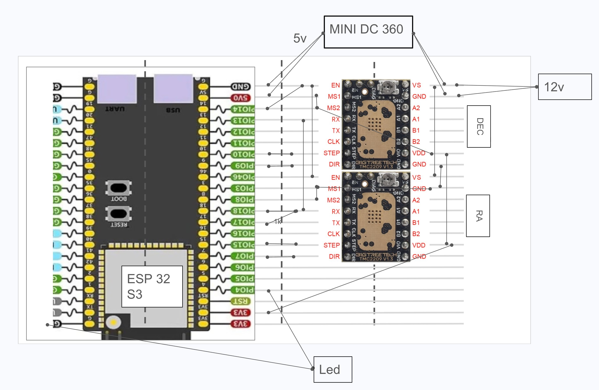
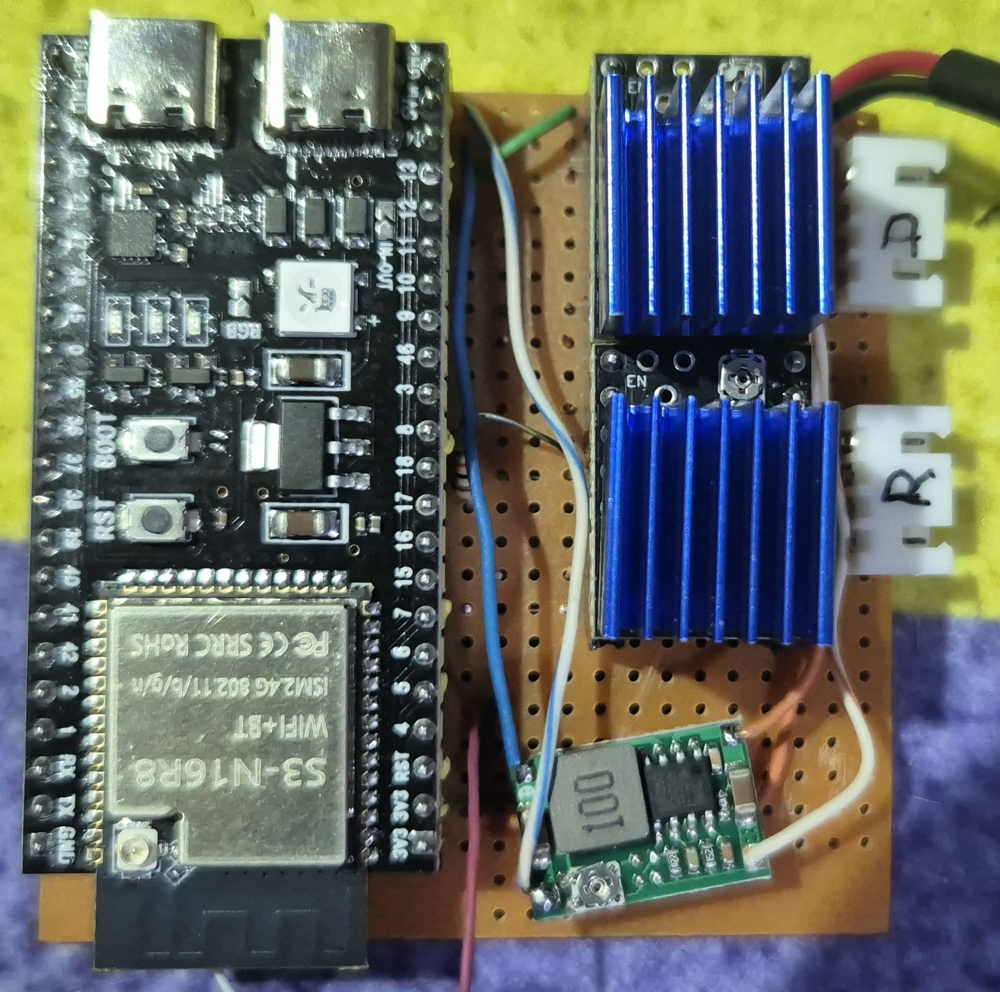

# monturita — No Precision Instruments Inc.

Montura ecuatorial DIY controlada por un ESP32-S3 a través de un protocolo serial
**USB CDC-ACM**. Una app de escritorio (**mount_panel**, en Go, repo aparte) es el
único cliente: traduce ese protocolo a Alpaca/ASCOM y a una UI para N.I.N.A. y PHD2.

Este firmware corre en una placa Hosyond ESP32-S3 N16R8, controlando dos motores
NEMA 17 a través de drivers TMC2209.


## Hardware

- **Placa**: Hosyond ESP32-S3 N16R8 (ESP32-S3-WROOM-1, USB-C, 16 MB flash, 8 MB PSRAM)
- **Drivers**: 2× TMC2209 (UART, StealthChop, 128 µsteps) — referencia técnica en [`TMC.md`](TMC.md)
- **Motores**: 2× NEMA 17 (1.8° por paso, 1.5 A nominales)
- **Reducción**: polea 20 dientes en el motor → 80 dientes en el eje (4:1)
- **Alimentación**: fuente 12 V 5 A + MINI DC 360 (12 V → 5 V)
- **LED**: indicador PWM (GPIO 4) — tenue en reposo, brillante en slew, beacon en error
- **Botones**: STOP (GPIO 16) y HOME (GPIO 21), inputs con pull-up interno
- **UART TMC2209**: bus unifilar compartido (GPIO 17 TX con resistencia 1 kΩ en serie, GPIO 18 RX), direccionamiento por MS1/MS2

### Pin mapping




| GPIO | Función          | Notas                          |
|------|------------------|--------------------------------|
| 4    | LED (PWM)        | Indicador de estado externo    |
| 7    | DEC DIR          | Dirección eje declinación      |
| 9    | RA DIR           | Dirección eje ascensión recta  |
| 10   | RA STEP          | Pulso STEP eje ascensión recta |
| 14   | MOTORS ENABLE    | Enable global compartido       |
| 15   | DEC STEP         | Pulso STEP eje declinación     |
| 16   | STOP button      | Input con pull-up interno      |
| 17   | TMC2209 UART TX  | Vía resistencia 1 kΩ en serie  |
| 18   | TMC2209 UART RX  | Bus unifilar                   |
| 21   | HOME button      | Input con pull-up interno      |

## Arquitectura

```
mount_panel (Go) — Alpaca + UI
  └─ USB CDC-ACM serial protocol
       └─ ESP32-S3: Proto → Mount → Motors → STEP/DIR (RMT)
```

- **usb_cdc** (`main/usb_cdc/`) — transporte CDC-ACM (TinyUSB): init, tarea RX, TX.
- **proto** (`main/proto/`) — protocolo serial: framing, dispatch, un handler por familia de mensajes, sesión (`boot_id`, `config_rev`, idempotencia).
- **mount** (`main/mount/`) — orquestación: estado, coordenadas, meridian flip, settings.
- **motors** (`main/motors/`) — movimiento: GPIO STEP/DIR, generación de pulsos por RMT+DMA.
- **tmc** (`main/tmc/`) — driver TMC2209 por UART (bus único, direccionamiento MS1/MS2).
- **led** (`main/led/`) — PWM GPIO 4: tenue / brillante / beacon.
- **config** (`main/config/config.h`) — única fuente de verdad de los parámetros de hardware.
- **runtime** (`main/runtime/`) — secuencia de init + ciclo periódico.

## Protocolo CDC-ACM (serial)

El ESP32-S3 habla un protocolo serial pequeño y determinista sobre USB CDC-ACM.
El `mount_panel` es el único cliente. El ESP es la autoridad sobre la montura:
publica un estado coherente y ejecuta un conjunto pequeño de operaciones.

**Framing**: trama = `[u32 little-endian length][JSON UTF-8]` (sin CRC de aplicación:
USB ya es fiable). Máximo ~2048 B por trama, buffers preasignados.

La especificación completa del protocolo (formato, semántica por familia, decisiones
de diseño) vive en [`main/proto/README.md`](main/proto/README.md).

## Setup

### Requirements

| Tool     | Version      | Purpose               |
|----------|--------------|-----------------------|
| ESP-IDF  | v6.0.1       | Sistema de build      |
| Python   | 3.10+ (venv) | Requerido por ESP-IDF |
| CMake    | 4.x          | Sistema de build      |
| Ninja    | 1.x          | Ejecutor de build     |

### Instalación en macOS

```sh
mkdir -p ~/.espressif
git clone --depth 1 --branch v6.0.1 https://github.com/espressif/esp-idf.git ~/.espressif/v6.0.1/esp-idf
export IDF_TOOLS_PATH="$HOME/.espressif/tools"
cd ~/.espressif/v6.0.1/esp-idf && bash install.sh esp32s3

brew install cmake ninja
```

Agregar a `~/.zshrc` (ajustar rutas a tu sistema):

```sh
export IDF_PATH="$HOME/.espressif/v6.0.1/esp-idf"
export IDF_TOOLS_PATH="$HOME/.espressif/tools"
export IDF_PYTHON_ENV_PATH="$HOME/.espressif/tools/python/v6.0.1/venv"
export PYTHON="$IDF_PYTHON_ENV_PATH/bin/python"
alias idf.py="$PYTHON $IDF_PATH/tools/idf.py"
```

### Build

```sh
idf.py set-target esp32s3
idf.py build flash monitor
```

## Convenciones del proyecto

- Lenguaje: **C** (C23), snake_case
- Un archivo `.c` por caso de uso dentro de cada módulo
- API pública: `module.h` — API interna: `module_internal.h`
- Prefijo de función igual al nombre del módulo (`motors_`, `mount_`, …)
- Dependencias: proto → mount → motors → tmc (sin dependencias reversas)
